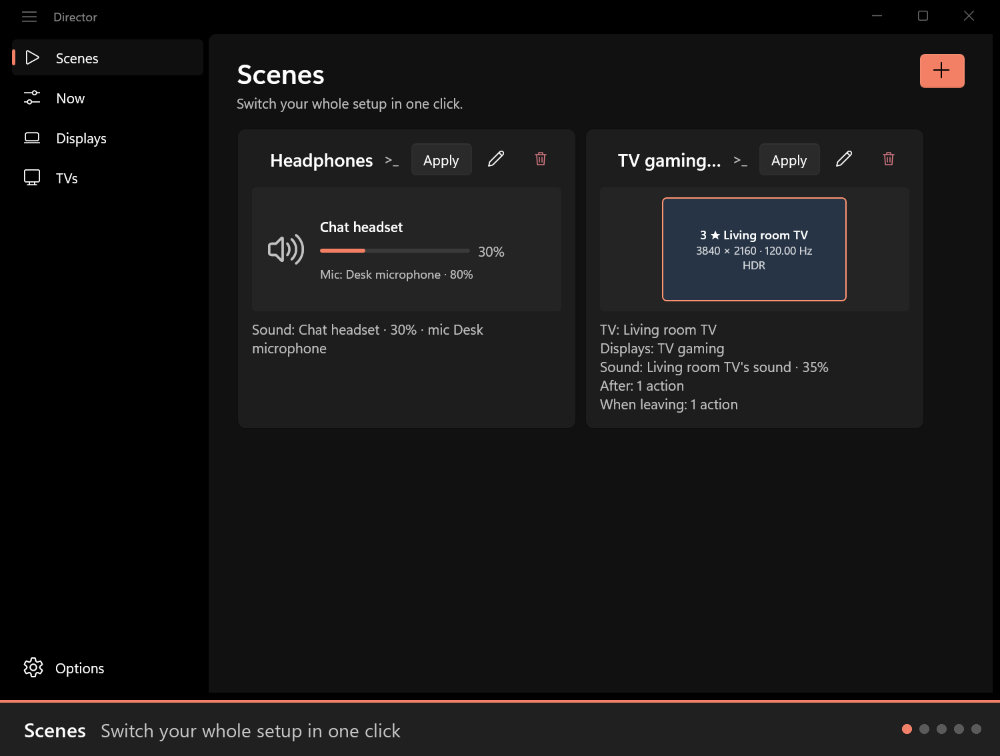
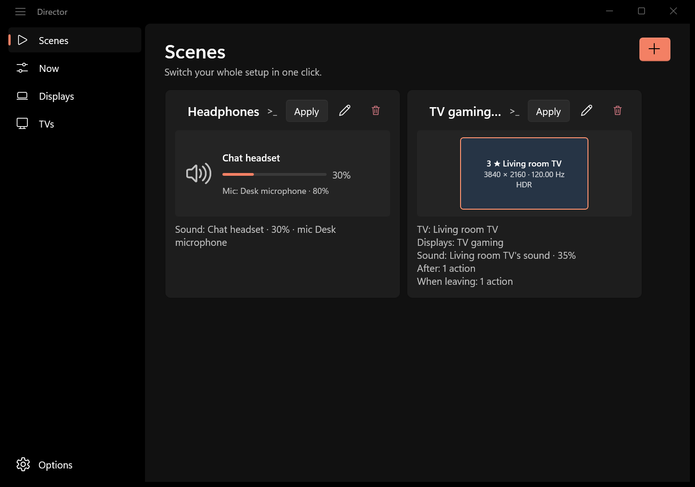
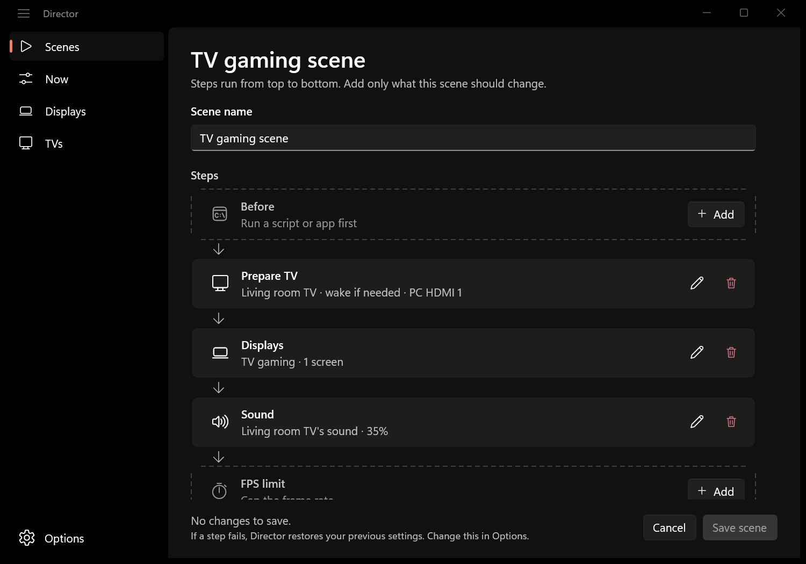
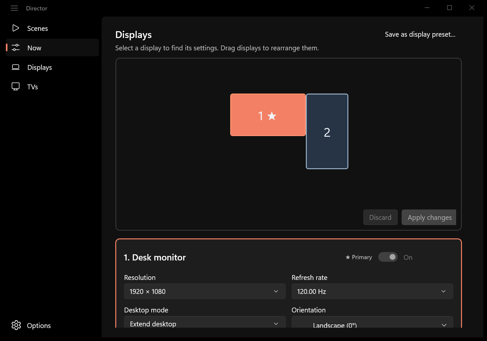
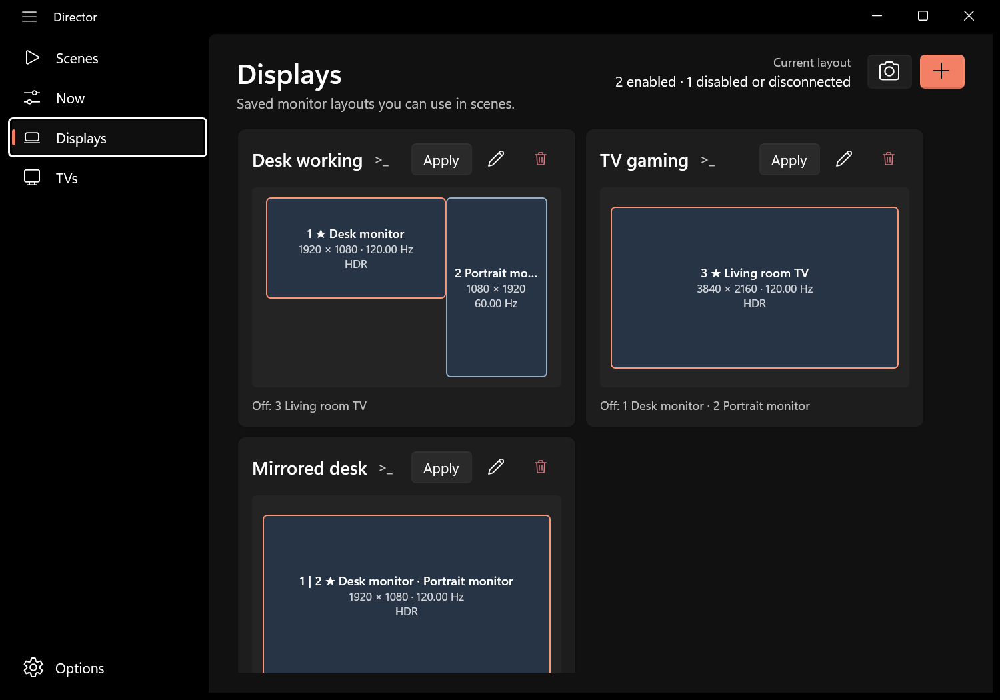
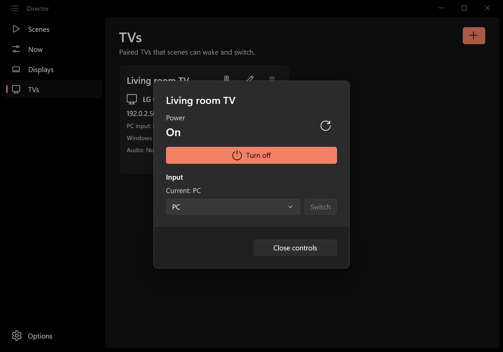

<p align="center"></p>
<h1 align="center">Director</h1>
<p align="center"><strong>Switch your monitors, sound, TV and frame-rate limit with one click.</strong><br>Desk to couch and back, from the window, a shortcut or a Stream Deck.</p>

<p align="center">
  <a href="https://github.com/Xarishark/Director/releases/latest"></a>
  
  <a href="https://github.com/Xarishark/Director/actions/workflows/windows-build.yml"></a>
  <a href="LICENSE"></a>
  <a href="https://github.com/sponsors/Xarishark"></a>
</p>

<p align="center"><a href="https://github.com/Xarishark/Director/releases/latest/download/Director-x64-setup.exe"></a></p>

<p align="center"></p>

<details>
<summary>All screenshots</summary>

| | |
| --- | --- |
|  |  |
| **Scenes**: switch everything in one click | **Scene steps**: run in order, undone together |
|  |  |
| **Now**: change screens, sound and FPS live | **Displays**: saved layouts with exact modes and HDR |
|  | |
| **TVs**: wake, switch inputs, turn off | |

</details>

Moving from your desk to the living room? A **TV Gaming** scene wakes the TV, switches it to your PC, turns on the TV as your only screen, sends the sound over HDMI, caps the frame rate and opens Steam Big Picture. A **Desk** scene puts it all back. Director checks every change it makes, and if any step fails it restores what it changed.

## Highlights

- 📺 **TV control built in.** Pair **LG webOS**, **Samsung Tizen** and **TCL Android / Google TV** TVs directly over your network to wake them, switch inputs and turn them off. You don't need Python or Node scripts, TV command-line tools or a companion app. LG is fully supported; Samsung and TCL support is an early trial that still needs testing on real TVs, and [test reports](docs/TV_TESTING.md) are very welcome. [TVs →](docs/TVS.md)
- 🎬 **Scenes run as one flow.** Before → TV → Displays → Sound → FPS limit → After, in that order, with each change checked. If a step fails, Director restores your displays, default devices, volumes and FPS limit together. [Scenes →](docs/SCENES.md)
- ⏳ **Waits for your hardware.** A scene waits for the TV to wake and report the right input, then for its HDMI audio to appear after the screens switch. It never quietly picks a different device. **TV input protection** takes the input back when a console or streaming box grabs it at power-on.
- 🎯 **Frame-rate limits.** Set the global NVIDIA or RTSS limit per scene, including a **VRR-safe cap** worked out from the refresh rate of the screen you just switched to. [FPS →](docs/FPS.md)
- 🚪 **Leave and come back.** When-leaving steps close what the scene opened (for example `steam://close/bigpicture`), turn the TV off, and **End** returns you to your desk scene.
- 🖥️ **Sets up screens that are off.** Detects a TV's real resolutions, refresh rates and HDR by turning it on briefly, then restores your layout, so you can build its preset while it's off. [Displays →](docs/DISPLAYS.md)

## What a scene can change

| Area | What you can set |
| --- | --- |
| **Displays** | Which screens are on, their arrangement and primary, resolution, exact refresh rate, orientation, extend or mirror, and HDR |
| **Sound** | Default output (or the TV's HDMI audio), volume, mute, a separate calls device, and the microphone with its own volume and mute |
| **TV** | Wake it, switch to your PC's input, keep that input, turn it off when you leave |
| **FPS limit** | Global NVIDIA or RTSS limit, a VRR-safe cap, or no limit |
| **Apps and links** | Run apps (optionally waiting for them), open links or URIs, close apps, before, after or when leaving |
| **Return** | The scene to go back to when you end this one: **End** (or running the scene again) runs its leave steps and then applies, say, your Desk scene |

**Now** changes the same things live without saving anything, and every command is also available from the [command line](#command-line).

## No helper tools needed

Director talks to Windows, the NVIDIA driver, RTSS and your TV directly, from one native app written in Rust with a WinUI 3 interface. Setups held together with NirCmd, display-switching command-line tools, rtss-cli or TV scripts can retire them.

**Still using an external command-line tool for something in this space?** If it's about displays, sound, TVs, frame-rate limits, or apps and links around a scene, [open a feature request](https://github.com/Xarishark/Director/issues/new?template=feature.yml) saying which tool and what you use it for. The goal is to build that into Director natively.

## Install

Director needs **Windows 11, version 24H2 or newer** (x64), because switching HDR per screen uses display APIs that Windows added in 24H2. Download **Director-x64-setup.exe** with the button above and run it. Setup installs the Windows App Runtime if it's missing and adds `director` to PATH. See [Install](docs/INSTALL.md) for quiet installs, updates and uninstalling.

## Quick start

1. Open **Scenes** and choose **Save everyday scene**. It saves your current screens, sound and FPS limit as a scene called Default, so you can always switch back in one click. Nothing on your PC changes.
2. In **TVs**, add your TV and follow its pairing guide. Link its Windows display and HDMI audio output.
3. In **Displays**, create a layout for the TV. If Windows hasn't shown the TV's modes yet, use **Set up this display** to detect them.
4. In **Scenes**, choose **+**, name it **TV Gaming**, and add the TV, the TV layout, **TV's sound** and any apps. Then **Apply** it.

## Command line

Every scene, preset, TV, screen and audio device has a CLI name: its name in lowercase with dashes, so "TV Gaming" is `tv-gaming`. The **>\_** button next to a name copies the exact command, ready for a [Stream Deck button or shortcut](#stream-deck-and-shortcuts).

```powershell
director scene apply tv-gaming
director scene end
director display apply desk-monitors
director audio volume +5
director tv toggle living-room-tv
director fps set nvidia vrr
director list
```

`director --help` lists every command. Commands run without opening the window and return a non-zero exit code when something fails.

## Stream Deck and shortcuts

To run a command from a Stream Deck button, a desktop shortcut or a hotkey tool without a terminal window ever appearing, start it through Windows' console host in headless mode:

```text
conhost.exe --headless cmd.exe /c director scene apply tv-gaming
```

On a Stream Deck, add a **System → Open** action and paste the whole line into its **App / File** field. Some useful buttons:

| Button | Command |
| --- | --- |
| Couch ↔ desk | `conhost.exe --headless cmd.exe /c director scene apply tv-gaming` |
| Back to desk | `conhost.exe --headless cmd.exe /c director scene end` |
| Volume up / down | `conhost.exe --headless cmd.exe /c director audio volume +5` (or `-5`) |
| Mute | `conhost.exe --headless cmd.exe /c director audio mute toggle` |
| TV on / off | `conhost.exe --headless cmd.exe /c director tv toggle living-room-tv` |

**One button to go to the couch and back.** Give your TV Gaming scene a **Return** step pointing at your Desk scene. The first press applies TV Gaming. Pressing the same button again while it's active runs its leave steps (for example closing Big Picture and turning the TV off) and applies Desk. With **Notify when CLI scenes fail** on in Options, a Windows notification tells you if a run didn't finish.

## Guides

- **Using Director:** [Scenes](docs/SCENES.md) · [Displays](docs/DISPLAYS.md) · [Sound](docs/SOUND.md) · [FPS limits](docs/FPS.md) · [TVs](docs/TVS.md)
- **Help:** [Install](docs/INSTALL.md) · [Troubleshooting, logs and backups](docs/TROUBLESHOOTING.md) · [Test a Samsung or TCL TV](docs/TV_TESTING.md)
- **Contributing:** [Development](docs/DEVELOPMENT.md) · [Architecture](docs/ARCHITECTURE.md) · [Interface design](docs/DESIGN.md)

## Contributing

Bug reports, TV test reports, feature requests and pull requests are welcome; see [CONTRIBUTING.md](CONTRIBUTING.md). Please report security problems privately as described in [SECURITY.md](SECURITY.md). Release notes are in [CHANGELOG.md](CHANGELOG.md).

## License

[MIT](LICENSE). Third-party components are listed in [THIRD_PARTY_LICENSES.md](THIRD_PARTY_LICENSES.md).
